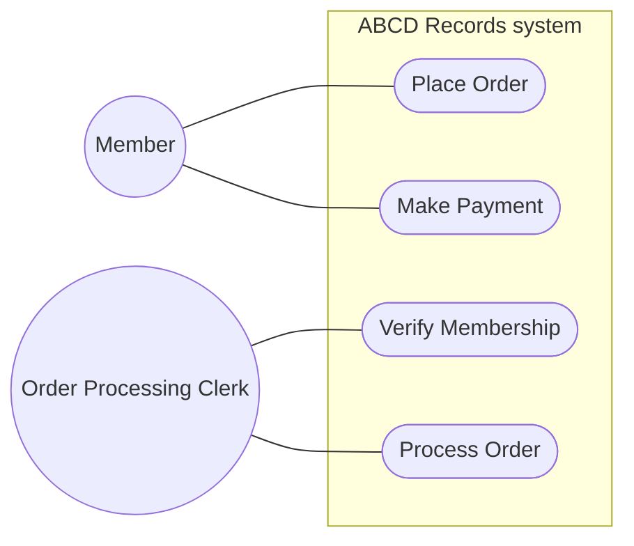
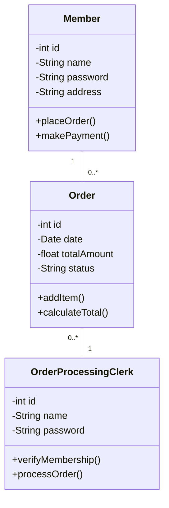

# ABCD Records: Level 1

## Task 1.1: Use case diagram

## Task 1.2: Class diagram

People classes take their methods from the use case diagram. Order is a thing, so its methods manage its own data (`calculateTotal()` fills in `totalAmount`).

