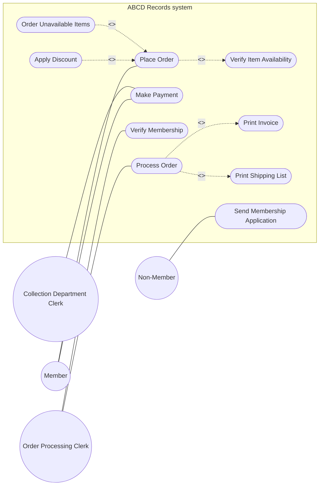
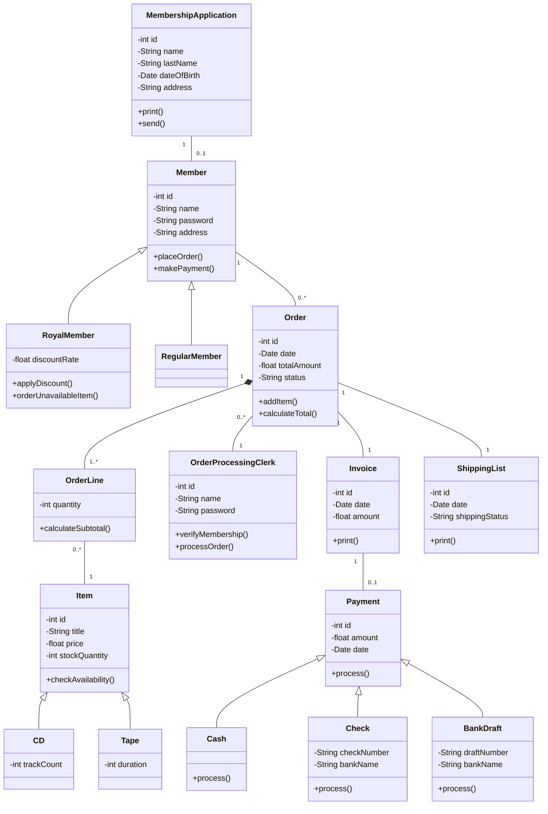

# ABCD Records: Level 2

## Task 2.1: Complete use case diagram

- `<<include>>` = always happens, arrow from the main use case to the included one.
- `<<extend>>` = only sometimes (e.g. only Royal members), arrow from the optional use case to the main one.

## Task 2.2: Complete class diagram

- 3 inheritance families: Member, Payment, Item.
- An Order is made of OrderLines (composition). An OrderLine is one row of the order: a quantity and the item it points to.
- Non-Member has no class, because the system stores nothing about non-members. The membership application is what turns them into a Member.

**Scenario check (Royal member orders 2 CDs, one unavailable, pays by check):** one Order with 2 OrderLines, each pointing to a CD. The unavailable CD is allowed because RoyalMember has `orderUnavailableItem()`, and the order status stays pending for that line. The payment is a Check linked to the order's Invoice.
