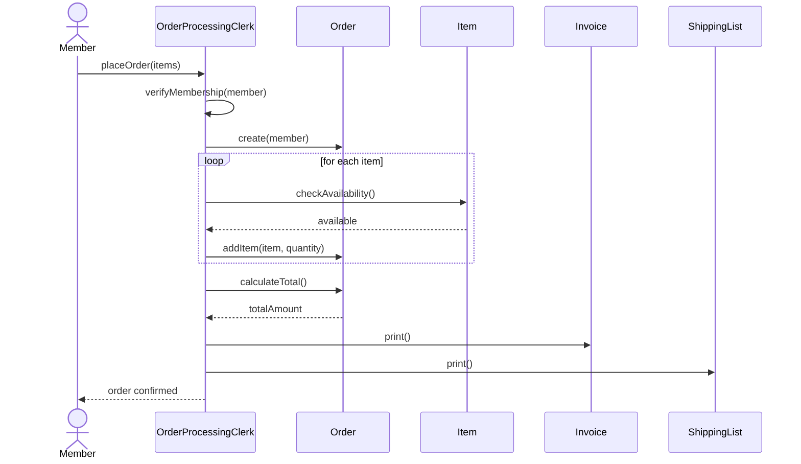
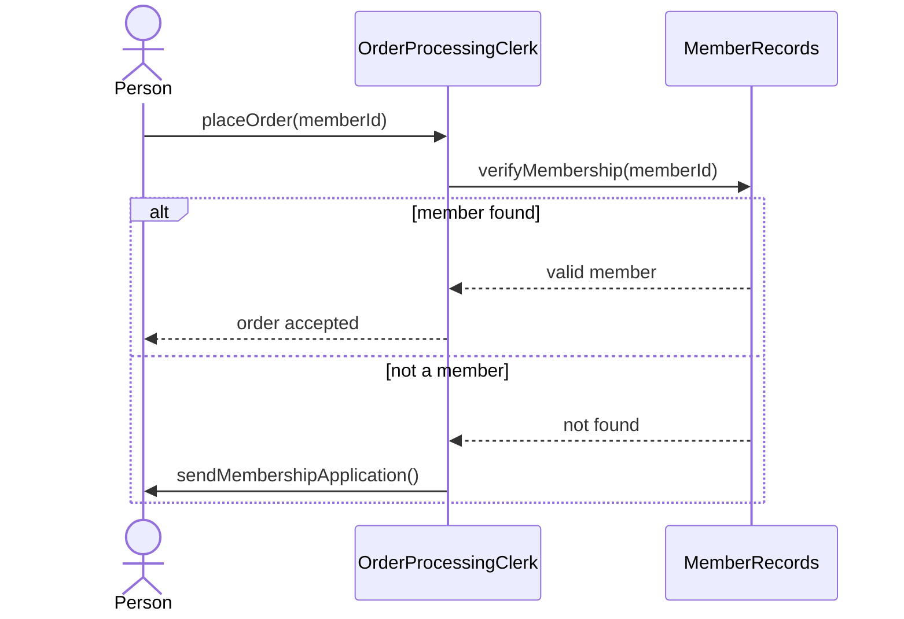
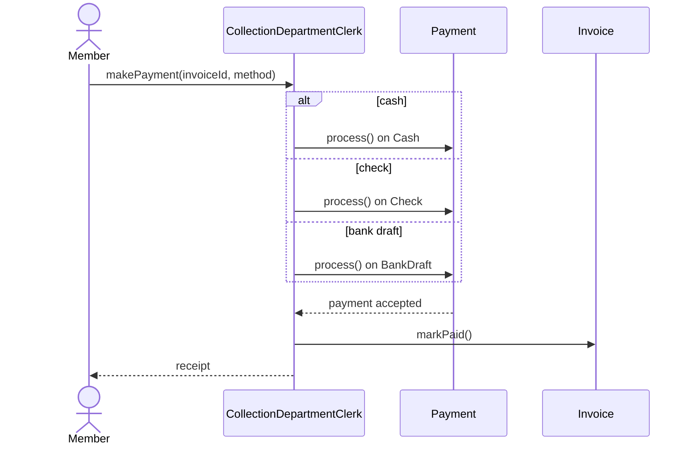
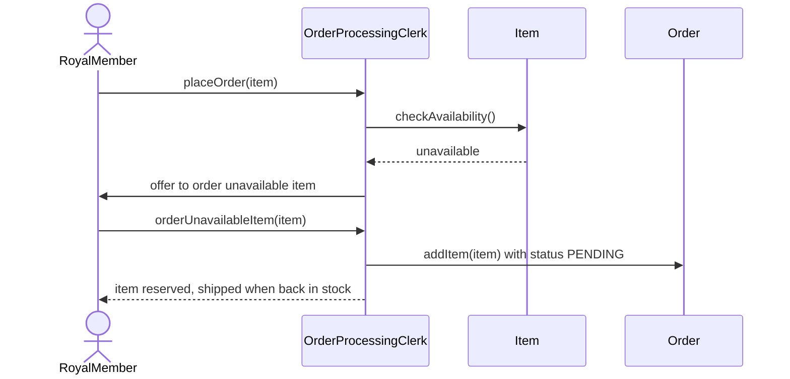

# ABCD Records: Level 3 sequence diagrams

Solid arrow = a request. Dashed arrow = the immediate reply.

## 1. Complete order processing flow

## 2. Membership verification

## 3. Payment processing (all types)

Each payment type rewrites `process()`, so the collection clerk calls the same method whatever the type (polymorphism).

## 4. Item reordering for Royal members

