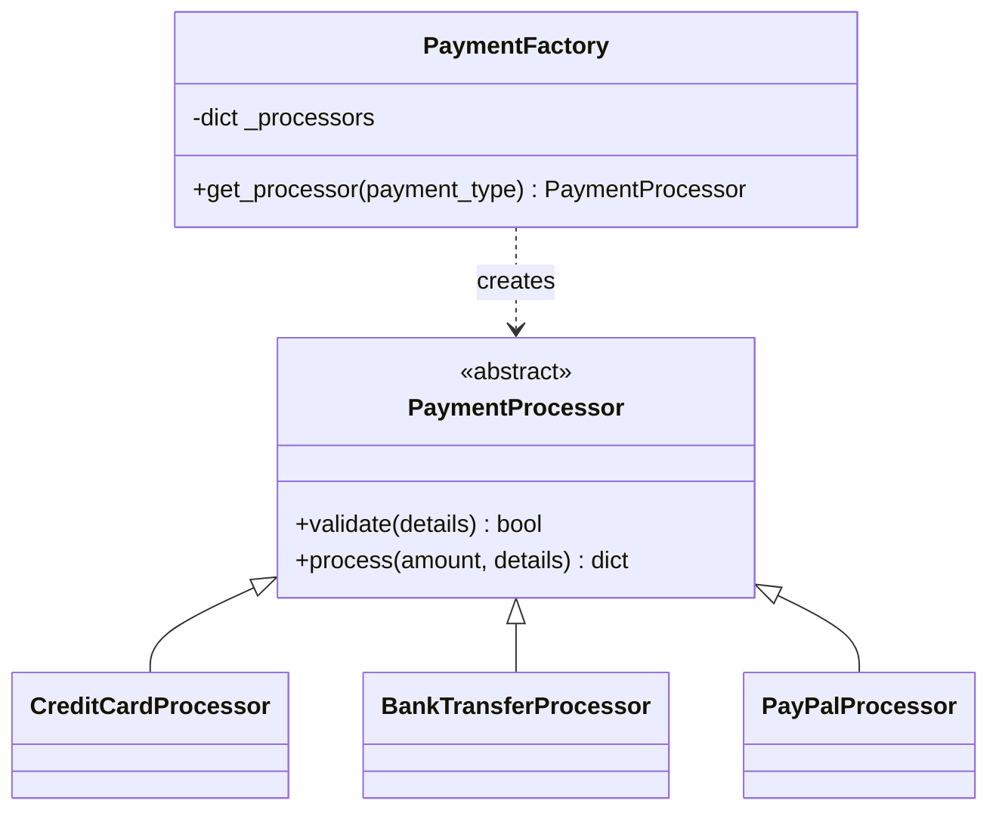
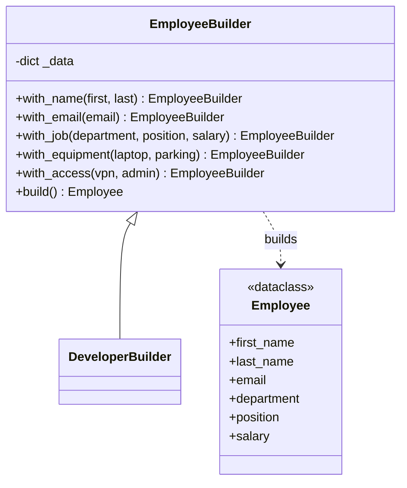
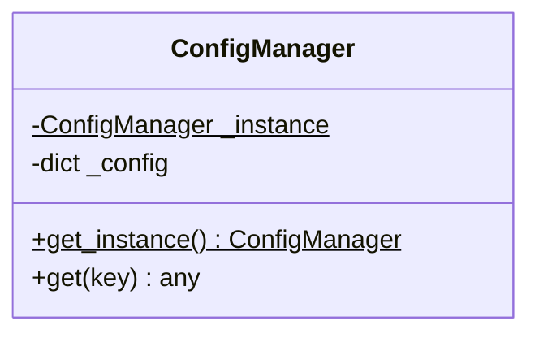
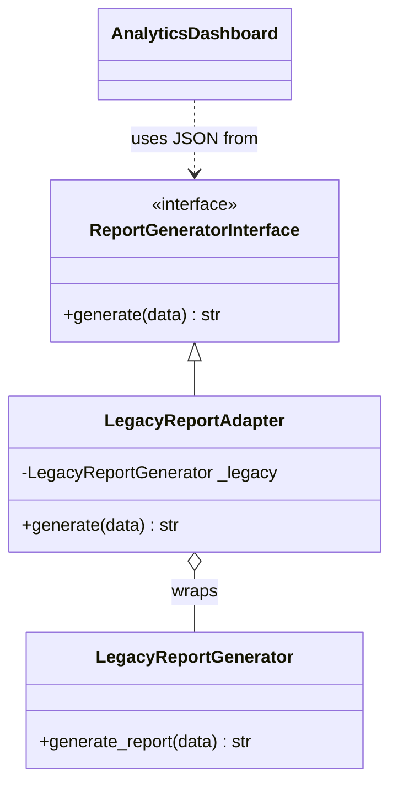
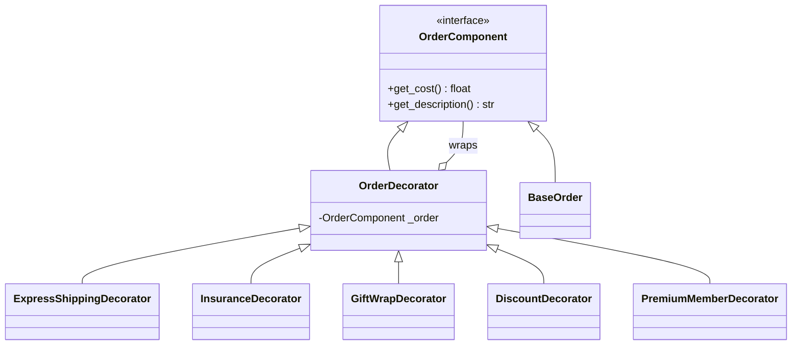
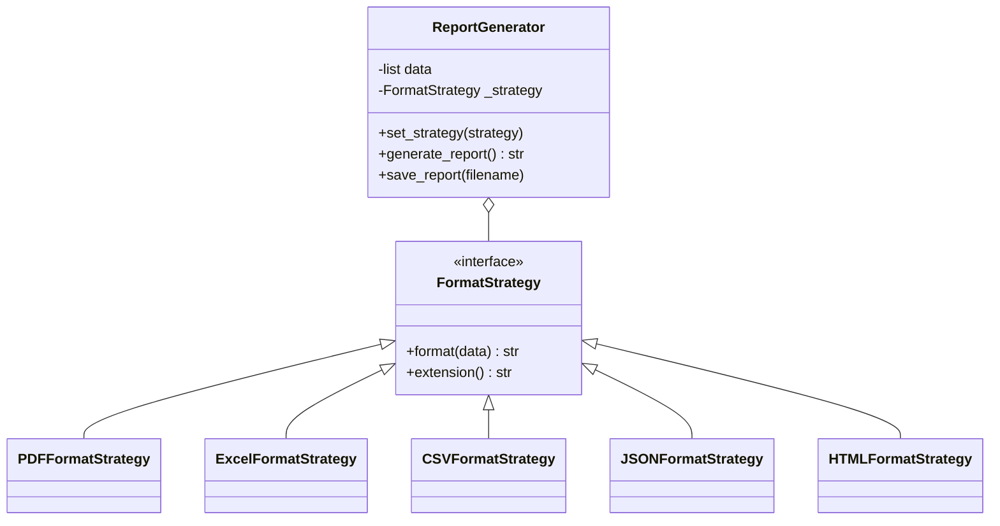
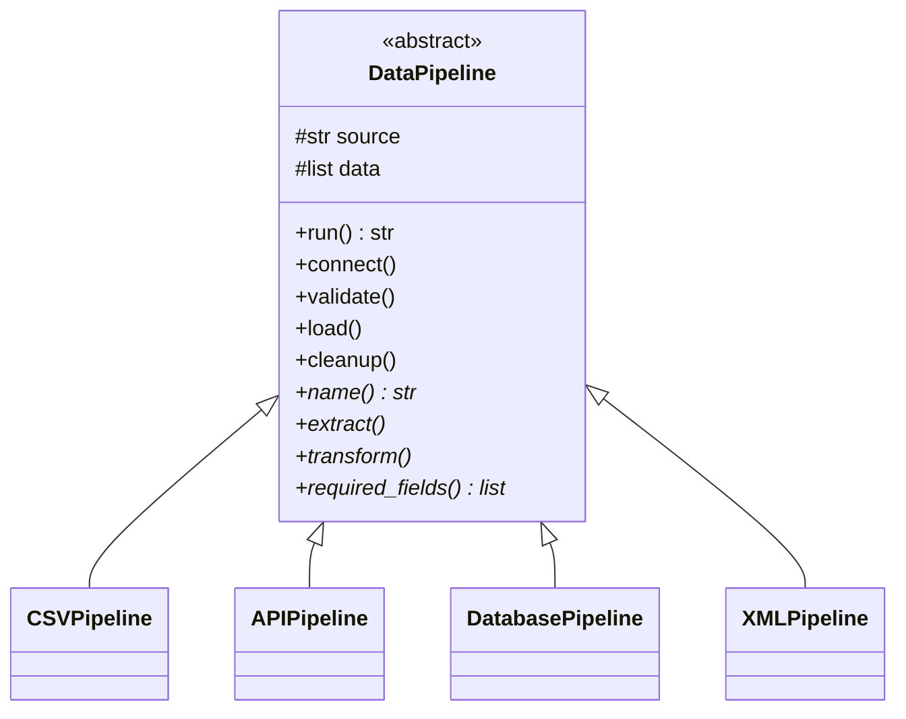

# Design patterns (slide 84)

Each exercise takes the "spaghetti" code from the course and refactors it with one pattern. The UML diagram for each solution is below, drawn before coding.

Run any file with `python3 <file>.py`.

| Family | Pattern | File | Problem it fixes |
| --- | --- | --- | --- |
| Creational | Factory Method | `creational/factory.py` | long if/elif on payment type |
| Creational | Builder | `creational/builder.py` | function with 17 parameters |
| Creational | Singleton | `creational/singleton.py` | config file loaded 4 times |
| Structural | Adapter | `structural/adapter.py` | legacy XML vs dashboard expecting JSON |
| Structural | Decorator | `structural/decorator.py` | boolean flags for order options |
| Behavioral | Strategy | `behavioral/strategy.py` | if/elif on report format |
| Behavioral | Template Method | `behavioral/template_method.py` | 3 pipelines with copy-pasted steps |

## Factory Method

## Builder

## Singleton

## Adapter

## Decorator

## Strategy

Problems with the original code: adding a format means editing `generate_report` and `save_report` (breaks Open/Closed), every format is tested through one big function, formats can't be switched cleanly at runtime, and the if/elif is duplicated in two methods.

## Template Method

Problems with the original code: validation, loading and cleanup were copied 3 times, adding logging means editing 3 classes, and nothing stopped a pipeline from skipping a step.

