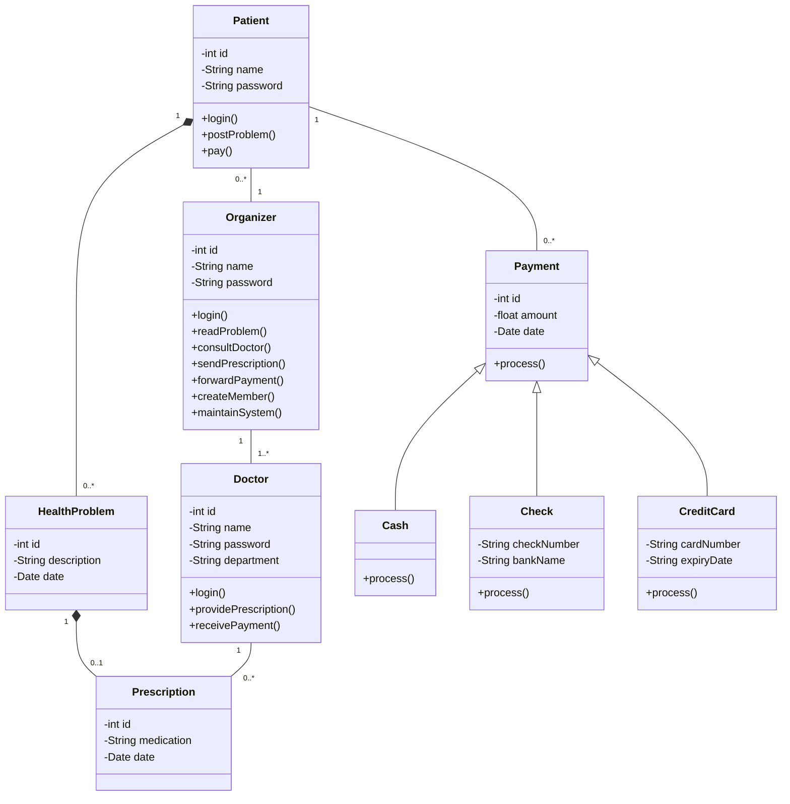
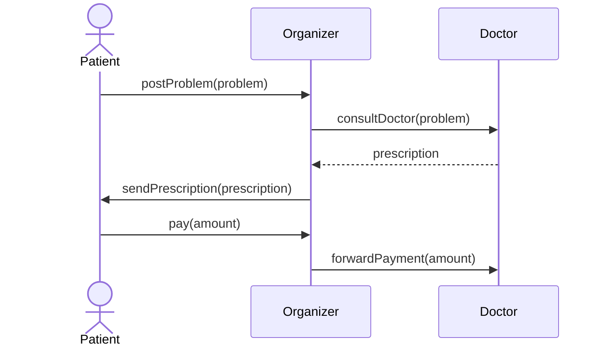

# Task 2: Complete class diagram + sequence diagram

## Class diagram

The patient's problem is no longer an attribute of Patient. It has its own details (description, date), so it becomes its own class.

- Patient owns its health problems (composition): if the patient is deleted, their problems go too.
- A health problem owns its prescription (composition).
- Doctor writes prescriptions (plain association): a prescription still exists if the doctor leaves.
- Payment types use inheritance. Each child rewrites `process()`.

## Sequence diagram: a patient submits a problem, receives a prescription and pays

Only arrow 3 is dashed, because it is the doctor's direct reply to request 2.

