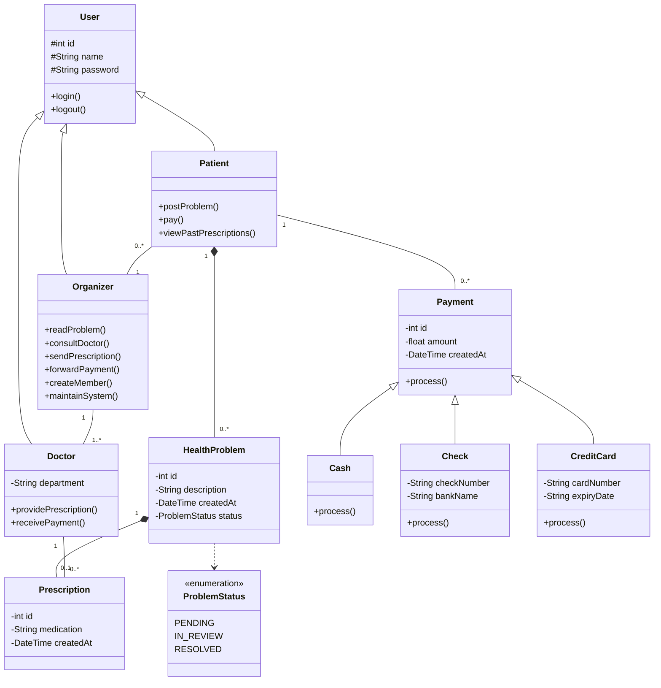
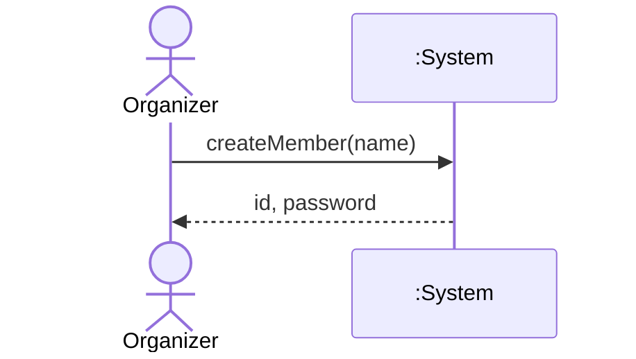
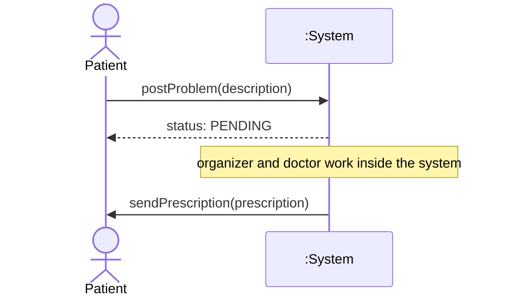
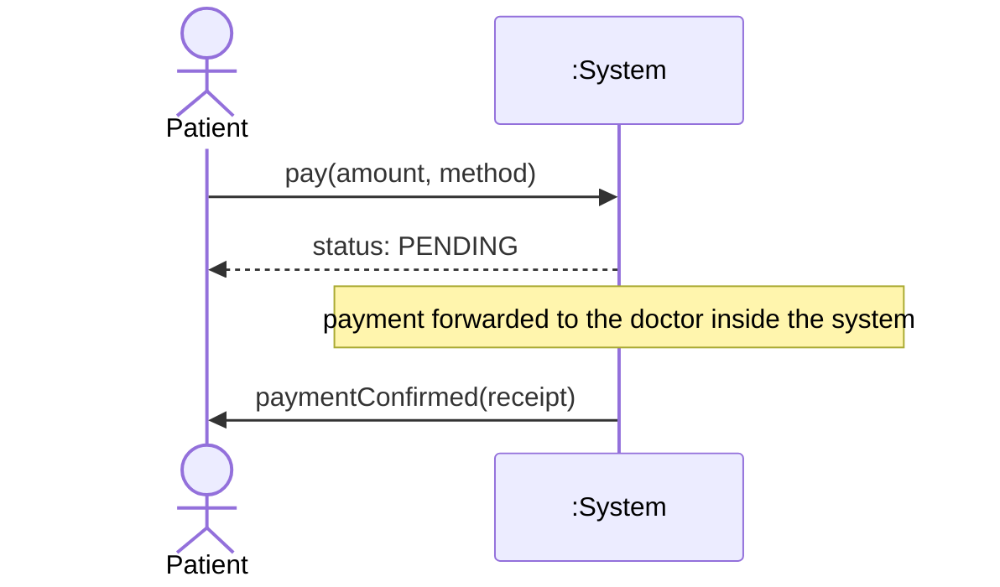

# Task 3: Advanced

## Class diagram changes

- New `User` superclass: Patient, Doctor and Organizer share id, name, password, login and logout. These are protected (`#`) because the children use them.
- `HealthProblem` gets a status, which can only be one of 3 values (enumeration).
- Dates become timestamps (`createdAt`).
- Patient can look back at old prescriptions with `viewPastPrescriptions()`.
- Payment types use polymorphism: each one rewrites `process()` (Strategy pattern).

## System sequence diagrams

In a system sequence diagram the whole app is one black box (`:System`). Only the human and the system are shown.

### 1. Patient registration

### 2. Consultation flow

### 3. Payment processing

## Questions to consider

1. **A patient consulting multiple doctors:** each health problem gets its own prescription from its own doctor, so a patient with 2 problems can already see 2 doctors. For one problem seen by several doctors, change HealthProblem to Prescription from `0..1` to `0..*`. No new box is needed, only a multiplicity.
2. **Reusable prescriptions:** no, a prescription belongs to one problem of one patient, which is why it is a composition. If it had to be shared (e.g. a standard treatment), it would become an aggregation instead.
3. **Design pattern for payments:** Strategy. Each payment method is its own class with its own `process()`, they are interchangeable, and a new method can be added without changing the others.
4. **Data integrity for payments:** keep `amount` private and only change it through `process()` (encapsulation), and give each payment a status so a payment that was taken but not forwarded is visible.
